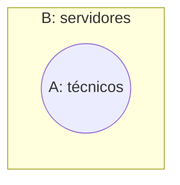

# Representando as categóricas

- **Todo A é B**: círculo A **dentro** de B
- **Nenhum A é B**: círculos **separados**
- **Algum A é B**: círculos com **interseção** marcada (pelo menos um elemento)
- **Algum A não é B**: parte de A **fora** de B marcada

---

# Testando conclusões

- Desenhe **todas** as possibilidades compatíveis com as premissas
- A conclusão é **necessária** se vale em **todos** os desenhos; **possível** se vale em pelo menos um
- Exemplo: "Todo técnico é servidor. Algum servidor é baiano." → "Algum técnico é baiano"? **Não necessariamente** — os baianos podem estar na parte de servidores fora dos técnicos

---

# Silogismo categórico válido

- P1: Todo analista é servidor. P2: Todo servidor é concursado. ∴ **Todo analista é concursado** ✓
- P1: Nenhum estagiário é servidor. P2: Algum estudante é estagiário. ∴ **Algum estudante não é servidor** ✓
- P1: Todo A é B. P2: Todo C é B. ∴ "Todo A é C"? ✗ (A e C podem ser disjuntos dentro de B)

::: quiz
? "Todo auditor é contador. Nenhum contador é desatento." Então, necessariamente:
- [ ] Algum desatento é auditor.
- [x] Nenhum auditor é desatento.
- [ ] Todo contador é auditor.
= Auditores estão dentro de contadores, que não tocam os desatentos.
:::

::: cartoes
Todo A é B (diagrama) :: A inteiramente dentro de B.
Nenhum A é B (diagrama) :: Conjuntos sem interseção.
Conclusão necessária :: Vale em todos os desenhos possíveis das premissas.
Todo A é B + Todo C é B ⇒ ? :: Nada se conclui entre A e C.
:::
