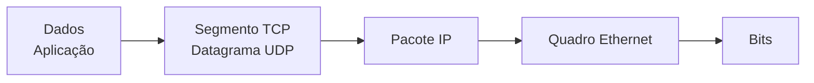

# Por que modelos em camadas?

- Dividem a comunicação em **funções independentes**: cada camada resolve um problema
- Cada camada **usa os serviços da inferior** e **presta serviço à superior**
- Trocar a tecnologia de uma camada não exige mudar as outras (Wi-Fi ↔ cabo, IPv4 ↔ IPv6)
- Facilitam padronização, diagnóstico (“em que camada está o problema?”) e ensino

> [!definicao] Protocolo
> Conjunto de regras (formato das mensagens, ordem, ações) que duas entidades **da mesma camada** usam para conversar.

---

# Modelo OSI — 7 camadas

| Nº | Camada | Função | Exemplos |
|---|---|---|---|
| 7 | Aplicação | Serviços ao usuário/aplicações | HTTP, DNS, SMTP, FTP |
| 6 | Apresentação | Formato, criptografia, compressão | TLS*, JPEG, ASCII/UTF-8 |
| 5 | Sessão | Abrir, manter e encerrar diálogos | RPC, NetBIOS |
| 4 | Transporte | Fim a fim entre processos (portas) | TCP, UDP |
| 3 | Rede | Endereçamento lógico e roteamento | IP, ICMP, OSPF |
| 2 | Enlace | Quadros no meio físico local (MAC) | Ethernet, Wi-Fi, PPP |
| 1 | Física | Bits como sinais | Cabos, fibra, rádio |

> [!memorize] De baixo para cima
> **F**ísica · **E**nlace · **R**ede · **T**ransporte · **S**essão · **A**presentação · **A**plicação

::: notas
O TLS costuma ser associado à camada de apresentação/sessão no OSI, mas na pilha TCP/IP fica "entre" aplicação e transporte. Bancas aceitam as duas leituras quando o enunciado não fixa o modelo.
:::

---

# Arquitetura TCP/IP — 4 camadas

::: colunas
- **Aplicação** = OSI 5 + 6 + 7
- **Transporte** = OSI 4
- **Internet** = OSI 3
- **Acesso à rede** (enlace/física) = OSI 1 + 2
+++
> [!prova] Pegadinha
> Algumas bancas usam um modelo **híbrido de 5 camadas** (Aplicação, Transporte, Rede, Enlace, Física). Leia o enunciado: quantas camadas ele considera?
:::

O OSI é **referência conceitual** (ISO/IEC 7498-1); o TCP/IP é a arquitetura **efetivamente usada** na Internet (RFC 1122).

---

# Encapsulamento e PDUs



- Ao **descer**, cada camada acrescenta seu **cabeçalho** (o quadro também tem *trailer*: FCS)
- Ao **subir**, o receptor retira os cabeçalhos — **desencapsulamento**
- PDU = *Protocol Data Unit*: **segmento → pacote → quadro → bits**

---

# Camada de transporte: TCP × UDP

::: colunas
### TCP
- Orientado a conexão: **three-way handshake** (SYN → SYN-ACK → ACK)
- Confiável: números de sequência, ACK, retransmissão
- Controle de **fluxo** (janela) e de **congestionamento**
- Entrega **ordenada** · ex.: HTTP, SSH, SMTP
+++
### UDP
- **Sem conexão**, sem confirmação
- Cabeçalho de 8 bytes: menor overhead e latência
- Pode perder, duplicar ou desordenar
- Ex.: DNS (consultas), DHCP, VoIP, streaming, jogos
:::

> [!atencao] DNS usa as duas
> Consultas comuns vão por **UDP 53**; respostas grandes e transferência de zona usam **TCP 53**.

---

# Portas que mais caem

| Porta | Serviço | Porta | Serviço |
|---|---|---|---|
| 20/21 | FTP (dados/controle) | 110 | POP3 |
| 22 | SSH / SFTP | 143 | IMAP |
| 23 | Telnet (texto puro!) | 161/162 | SNMP (UDP) |
| 25 | SMTP | 389 / 636 | LDAP / LDAPS |
| 53 | DNS | 443 | HTTPS |
| 67/68 | DHCP (UDP) | 3306 / 5432 | MySQL / PostgreSQL |
| 80 | HTTP | 3389 | RDP |

> [!dica] Faixas
> **Bem conhecidas** 0–1023 · **registradas** 1024–49151 · **dinâmicas/efêmeras** 49152–65535.

---

# Camada de rede

- **IP**: endereçamento lógico e encaminhamento salto a salto, **sem conexão e sem garantia** (melhor esforço)
- **ICMP**: mensagens de controle e erro — `ping` (echo request/reply) e `traceroute` (TTL excedido)
- **ARP** resolve IP → MAC na rede local (fica entre as camadas 2 e 3)
- Roteamento: **estático** ou **dinâmico** — RIP (vetor distância, saltos), OSPF (estado de enlace, custo), BGP (entre sistemas autônomos)

```bash
ping -c 3 192.168.0.1      # testa alcance (ICMP)
traceroute 8.8.8.8         # mostra os saltos (TTL)
ip route                   # tabela de rotas no Linux
```

---

# Camada de enlace

- Entrega **quadros** entre nós do **mesmo enlace**, usando **endereço MAC** (48 bits, ex. `3C:52:82:1A:9F:04`)
- Detecção de erros com **FCS/CRC** no trailer do quadro
- Subcamadas (IEEE 802): **LLC** (controle do enlace lógico) e **MAC** (acesso ao meio)
- Acesso ao meio: **CSMA/CD** (Ethernet half-duplex, legado) e **CSMA/CA** (Wi-Fi 802.11)
- **VLAN (802.1Q)** separa domínios de broadcast no mesmo switch

---

# Equipamentos por camada

| Equipamento | Camada | O que faz |
|---|---|---|
| Hub, repetidor | 1 — Física | Repete o sinal para todas as portas (um domínio de colisão) |
| Switch, bridge | 2 — Enlace | Encaminha pela tabela de MACs; cada porta = domínio de colisão |
| Roteador | 3 — Rede | Encaminha pacotes entre redes; separa domínios de broadcast |
| Switch L3 | 2 e 3 | Comuta e roteia (ex.: entre VLANs) |
| Firewall/proxy/WAF | 3 a 7 | Filtra por endereço, porta ou conteúdo |

> [!prova] Domínios
> **Switch** separa domínios de **colisão**; **roteador** separa domínios de **broadcast**. Hub não separa nenhum.

---

## Revisão rápida

Teste-se antes das questões.

---

# Quiz

::: quiz
? Em qual camada do modelo OSI o roteador toma suas decisões de encaminhamento?
- [ ] Enlace
- [x] Rede
- [ ] Transporte
- [ ] Sessão
= O roteador usa o endereço lógico (IP), da camada 3 — Rede. O switch comum trabalha com MAC, na camada 2.
:::

---

# Quiz

::: quiz
? Qual PDU corresponde à camada de transporte quando o protocolo é o TCP?
- [x] Segmento
- [ ] Pacote
- [ ] Quadro
- [ ] Bit
= TCP gera segmentos; UDP, datagramas. Pacote é da camada de rede e quadro, da de enlace.
:::

---

# Resumo

- OSI: 7 camadas de referência; TCP/IP: 4 camadas usadas na prática
- Encapsulamento: dados → segmento → pacote → quadro → bits
- TCP é confiável e orientado a conexão; UDP é rápido e sem conexão
- Hub (1), switch (2), roteador (3) — e os domínios que cada um separa
- Pratique no **laboratório de Redes**: monte a topologia e diagnostique falhas por camada

::: cartoes
Quantas camadas tem o modelo OSI? :: 7 — Física, Enlace, Rede, Transporte, Sessão, Apresentação e Aplicação.
Quais são as 4 camadas do TCP/IP? :: Aplicação, Transporte, Internet e Acesso à rede.
PDU da camada de enlace :: Quadro (frame).
PDU da camada de rede :: Pacote.
Handshake do TCP :: SYN → SYN-ACK → ACK (three-way handshake).
Porta do SSH :: 22 (TCP).
Porta do DNS :: 53 — UDP nas consultas, TCP em respostas grandes e transferência de zona.
Switch separa domínios de… :: Colisão (cada porta é um domínio de colisão).
Roteador separa domínios de… :: Broadcast.
Protocolo que resolve IP em MAC :: ARP.
:::
